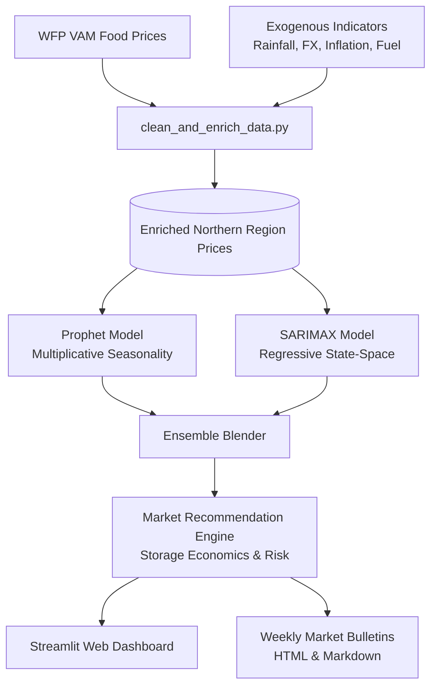

# Crop Price Prediction & Market Recommendations (Malawi)

## Overview
This repository implements an end-to-end short-term (2–4 weeks) and seasonal (12 weeks) price forecasting and market recommendation system for key staple and cash crops in the **Northern Region of Malawi** (**Maize**, **Beans**, **Groundnuts**, **Rice**, **Soya beans**, and **Tomatoes**).

The system integrates food commodity market data (**WFP VAM**, **FAMIS Malawi**, **FEWS NET**) with macroeconomic and climate drivers (**World Bank** exchange rates and inflation, **Open-Meteo** historical rainfall, and fuel tariffs) to provide actionable advice for smallholder farmers, commercial aggregators, and school feeding procurement committees.

---

## Quick Start

```powershell
# 1. Open the repository directory
cd "C:/Users/LOUIS KEYON/.gemini/antigravity/brain/11a23fa9-9fb0-47a8-9b19-97a98b8735b3/crop_price_prediction_malawi"

# 2. Activate virtual environment
.\.venv\Scripts\activate

# 3. (Optional) Install dependencies
pip install -r requirements.txt

# 4. Run the full automated pipeline (Ingest → Enrich → Forecast → Recommendations → Reports)
.\.venv\Scripts\python.exe automation/run_all.py
# (Or on Windows, double click automation\run_all.bat)

# 5. Launch the interactive dashboard
streamlit run app/streamlit_app.py
```

---

## System Architecture



---

## Project Layout

- **`data_ingest/`**
  - `fetch_wfp_data.py` – Ingests raw food price datasets from HDX / WFP VAM with caching and timeout failovers.
  - `fetch_exogenous_data.py` – Retrieves Northern Region climate trends, official MWK/USD rates, and fuel logistics indicators.
- **`data_preprocess/`**
  - `clean_and_enrich_data.py` – Harmonizes commodity taxonomies (isolates Soya beans from Beans), performs unit outlier correction (50kg vs 1kg), calculates monthly median prices, and generates lag and seasonal features.
- **`forecast/`**
  - `models.py` – Implements Prophet, SARIMAX, and Ensemble forecasters with 80% & 95% confidence cones and validation metrics (MAE, RMSE, MAPE).
  - `recommendations.py` – Strategic advisory logic evaluating grain storage economics (~2.5%/mo carrying costs) vs projected price appreciation.
  - `train_and_forecast.py` – Runs automated training and multi-crop forecast generation.
- **`app/`**
  - `streamlit_app.py` – Modern interactive dashboard featuring price trajectories, confidence cones, macro driver correlations, what-if stress testing simulator, and single-click bulletin downloads.
- **`reports/`**
  - `generate_weekly_report.py` – Compiles weekly market bulletins in Markdown and printable HTML.
- **`automation/`**
  - `run_all.py` – Python orchestrator for the 5-step automated workflow.
  - `run_all.bat` – Windows batch script for one-click execution.
  - `run_all.sh` – Bash script for Linux / WSL execution.
  - `setup_scheduled_task.ps1` – Windows Task Scheduler script to run weekly on Monday at 6:00 AM.

---

## Market Decision Logic

| Primary Action Badge | Criteria & Agricultural Context | Stakeholder Advisory |
| :--- | :--- | :--- |
| **`HOLD & STORE`** | Price projected to rise > 12% over 12 weeks, exceeding monthly carrying costs (~2.5%/mo). | Smallholders and cooperatives store storable grains using hermetic bags (PICS) to capture lean season price peaks. |
| **`SELL NOW`** | Price projected to soften (-3% or more) due to harvest supply expansion or perishable crop (Tomatoes). | Farmers offload produce immediately to regional depots in Mzuzu and Karonga to avoid post-harvest losses. |
| **`PROCURE NOW`** | Commodity currently near seasonal trough before anticipated lean season price surge. | School feeding programs and institutional buyers lock in bulk purchase contracts before prices jump. |
| **`MONITOR`** | Projected price movements within standard ±3% equilibrium band. | Continue standard staggered marketing. |

---

## Verification & Testing

To test the complete workflow and verify that all models train and all outputs are produced:
```powershell
.\.venv\Scripts\python.exe automation/run_all.py
```
This produces:
- `data/processed/clean_northern_region_enriched_prices.csv` (1,686 rows)
- `data/forecasts/crop_price_forecasts.csv` (36 forecast rows with 80% & 95% intervals)
- `data/forecasts/model_evaluation_metrics.csv` (MAE, RMSE, MAPE per model)
- `data/forecasts/market_recommendations.csv` (Action badges, risk scores, storage margins)
- `reports/weekly_market_bulletin_latest.html` (Printable bulletin)
