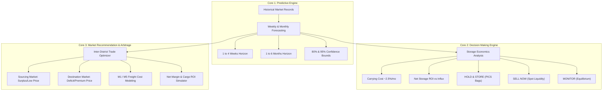

# AgriPrice Malawi — National Crop Price & Decision Intelligence System

## Executive Overview
**AgriPrice Malawi** is an enterprise-grade agricultural market intelligence, price forecasting, and inter-district trade arbitrage platform. It is engineered to assist smallholder farmers, grain cooperatives (NASFAM, regional clubs), commercial aggregators, and institutional buyers (ADMARC, NFRA, WFP) in making data-driven marketing decisions.

### Core Focus:
- **Commodities**: **Maize (Chimanga)**, **Rice (Mpunga)**, and **Beans (Nyemba)**.
- **Coverage**: **All 28 Districts across Malawi** (Northern, Central, and Southern regions).
- **Backend Architecture**: **Django & Django REST Framework** delivering modular, real-time analytics APIs.
- **Frontend Architecture**: **Enterprise Web Dashboard** powered by Tailwind CSS, Chart.js time-series curves with 80% & 95% confidence cones, interactive Leaflet geographic maps, and cargo profitability simulators.

---

## The Three Core Pillars



### 1. Prediction (District-Level Forecasting)
- Short-term **Weekly Forecasts (1 to 4 Weeks)** for immediate marketing decisions.
- Medium-term **Monthly Forecasts (1 to 6 Months)** for seasonal storage planning.
- Statistical confidence cones (80% and 95% uncertainty intervals).
- Dynamic **Ground-Truth Calibration**: Allows enumerators or supervisors to input today's spot price to re-anchor the forecast curve in real time.

### 2. Decision Making (Hold & Store vs. Sell Now)
- Evaluates **storage economics** against a benchmark monthly carrying cost of **~2.5%/month** (PICS hermetic bags amortization, warehousing, and cost of capital).
- Delivers unambiguous status badges:
  - **`HOLD & STORE`**: Projected price appreciation exceeds storage carrying costs with positive net return.
  - **`SELL NOW`**: Prices are softening or projected gains do not cover monthly carrying costs.
  - **`MONITOR`**: Market is in equilibrium; staggered selling advised.
- Actionable advisories tailored for **Smallholders**, **Cooperatives**, and **Institutional Buyers**.

### 4. Market Bulletins & Email Subscriptions
- Direct email registration for automated market bulletins.
- Customizable delivery schedule: **Weekly Bulletins (Masabata Onse)**, **Monthly Strategic Outlook (Mwezi Uliwonse)**, or **Both**.
- Automated instant bulletin testing tool right from the user bar.

### 5. Ground Calibration & Plain Language (with Chichewa)
- Prominent **Spot Price Calibration Bar** on the main dashboard for instant recalculation of forecasts and trade corridors from field observations.
- Bilingual metrics and advisories in **Simple English** and **Chichewa** for farmers, cooperatives, and district extension officers.
- Clean, executive interface with official branding, zero emojis, and pure Esri cartography without watermarks.
- Interactive **Cargo Volume Simulator (1 MT to 30 MT)** calculating total capital outlay, freight expenses, and net profit in MWK.
- Surfaces the **Top 10 Most Lucrative Arbitrage Corridors** nationwide.

---

## Quick Start (How to Launch for Presentation)

### Option A: One-Click Launch (Windows)
Double-click:
```bat
run_server.bat
```

### Option B: Terminal Launch
```powershell
# 1. Navigate to the project directory
cd crop_price_prediction_malawi

# 2. Run the server launcher (starts Django and opens browser automatically)
python run_server.py
```
Open **[http://127.0.0.1:8000/](http://127.0.0.1:8000/)** in your browser.

---

## REST API Endpoints

| Endpoint | Method | Description |
| :--- | :--- | :--- |
| `/api/districts/` | `GET` | All 28 districts with geographic coordinates, region, and market classifications. |
| `/api/commodities/` | `GET` | Metadata and storage parameters for Maize, Rice, and Beans. |
| `/api/predictions/?district={id}&commodity={name}` | `GET` | Historical prices, 4-week forecasts, and 6-month forecasts with 80%/95% confidence intervals. |
| `/api/decisions/?district={id}&commodity={name}` | `GET` | Strategic action badge, storage carrying economics, net margin, and stakeholder advisories. |
| `/api/arbitrage/?origin={id}&commodity={name}&tonnage={mt}` | `GET` | Ranked destination selling markets from the selected origin with freight tariffs and net ROI. |
| `/api/arbitrage/top/?commodity={name}&limit=10` | `GET` | Top 10 most profitable inter-district trade corridors across Malawi. |

---

## Geographic & Commodity Coverage

### 28 Districts of Malawi:
- **Northern Region (6)**: Chitipa, Karonga, Likoma, Mzimba, Nkhata Bay, Rumphi.
- **Central Region (9)**: Dedza, Dowa, Kasungu, Lilongwe, Mchinji, Nkhotakota, Ntcheu, Ntchisi, Salima.
- **Southern Region (13)**: Balaka, Blantyre, Chikwawa, Chiradzulu, Machinga, Mangochi, Mulanje, Mwanza, Neno, Nsanje, Phalombe, Thyolo, Zomba.

### Core Commodities:
- **Maize (*Zea mays* / Chimanga)**: Malawi's primary staple; subject to post-harvest price spikes during the hunger season (Dec–Mar).
- **Rice (*Oryza sativa* / Mpunga)**: Premium cash crop (Kilombero, Faya); strong urban demand centers in Blantyre, Lilongwe, and Zomba.
- **Beans (*Phaseolus vulgaris* / Nyemba)**: Major protein legume; high storage returns when preserved in hermetic PICS bags.
