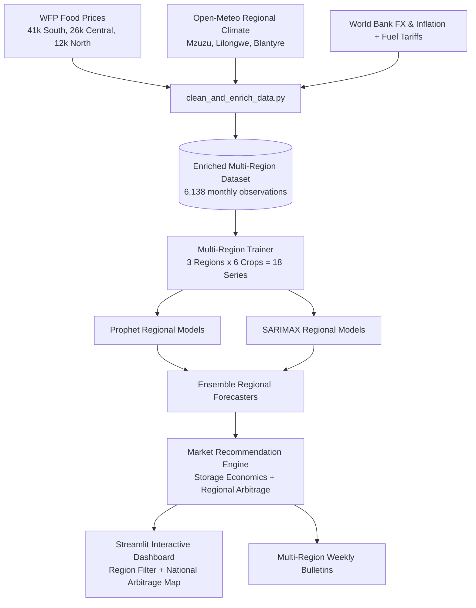

# Malawi Crop Price Prediction & Market Intelligence System

## Overview
This repository implements an end-to-end short-term (2–4 weeks) and seasonal (12 weeks) price forecasting, strategic market advisory, and **inter-regional arbitrage platform** for key staple and cash crops across all three agro-economic regions of Malawi:
- **Northern Region** (Mzuzu, Karonga, Chitipa, Rumphi, Nkhata Bay, Mzimba)
- **Central Region** (Lilongwe, Kasungu, Dedza, Salima, Dowa, Mchinji)
- **Southern Region** (Blantyre, Zomba, Mangochi, Mulanje, Chikwawa, Nsanje)

Target Commodities: **Maize**, **Beans**, **Groundnuts**, **Rice**, **Soya beans**, and **Tomatoes**.

The system integrates food commodity market data (**WFP VAM**, **FAMIS Malawi**, **FEWS NET**) with macroeconomic and climate drivers (**World Bank** exchange rates and inflation, **Open-Meteo** historical regional rainfall/temperatures, and fuel logistics tariffs) with dedicated machine learning models for each region and commodity.

---

## Quick Start

```powershell
# 1. Open the repository directory
cd "C:/Users/LOUIS KEYON/.gemini/antigravity/brain/11a23fa9-9fb0-47a8-9b19-97a98b8735b3/crop_price_prediction_malawi"

# 2. Activate virtual environment
.\.venv\Scripts\activate

# 3. (Optional) Install dependencies
pip install -r requirements.txt

# 4. Run the full automated pipeline (Ingest → Enrich → Multi-Region Forecast → Arbitrage → Bulletins)
.\.venv\Scripts\python.exe automation/run_all.py
# (Or on Windows, double click automation\run_all.bat)

# 5. Launch the interactive dashboard
streamlit run app/streamlit_app.py
```

---

## System Architecture



---

## Project Layout

- **`data_ingest/`**
  - `fetch_wfp_data.py` – Ingests raw food price datasets from HDX / WFP VAM for all regions with caching and timeout failovers.
  - `fetch_exogenous_data.py` – Retrieves regional Open-Meteo climate data (Mzuzu, Lilongwe, Blantyre), official MWK/USD rates, and fuel logistics indicators.
- **`data_preprocess/`**
  - `clean_and_enrich_data.py` – Harmonizes commodity taxonomies, cleans bag vs kg unit errors, aggregates monthly median prices across all 3 regions, and computes lag/seasonal features.
- **`forecast/`**
  - `models.py` – Implements Prophet, SARIMAX, and Ensemble forecasters with 80% & 95% confidence cones and validation metrics (MAE, RMSE, MAPE).
  - `recommendations.py` – Strategic advisory logic evaluating grain storage economics (~2.5%/mo carrying costs) and **inter-regional arbitrage spreads** against freight costs (~140 MWK/kg).
  - `train_and_forecast.py` – Automated training loop for all 18 region-crop pairs.
- **`app/`**
  - `streamlit_app.py` – Interactive dashboard featuring regional filters, cross-regional comparison charts, inter-regional trade opportunity cards, what-if stress tester, and bulletin downloads.
- **`reports/`**
  - `generate_weekly_report.py` – Compiles national and regional market bulletins in Markdown and printable HTML.
- **`automation/`**
  - `run_all.py` – Python orchestrator for the automated workflow.
  - `run_all.bat` – Windows batch script for one-click execution.
  - `setup_scheduled_task.ps1` – Windows Task Scheduler script to run weekly on Monday at 6:00 AM.

---

## Market Decision Logic & Arbitrage Rules

| Action / Badge | Criteria & Agricultural Context | Stakeholder Advisory |
| :--- | :--- | :--- |
| **`HOLD & STORE`** | Price projected to rise > 12% over 12 weeks, exceeding monthly carrying costs (~2.5%/mo). | Smallholders and cooperatives store storable grains using hermetic bags (PICS) to capture lean season price peaks. |
| **`SELL NOW`** | Price projected to soften (-3% or more) due to harvest supply expansion or perishable crop (Tomatoes). | Farmers offload produce immediately to regional depots to avoid post-harvest losses. |
| **`TRADE OPPORTUNITY`** | Inter-regional price spread exceeds M1 corridor freight costs (~140 MWK/kg) with $\ge 15\%$ ROI. | Cooperatives and aggregators buy in surplus/low-price regions (e.g. Central) and offload in deficit/premium regions (e.g. Southern). |
| **`MONITOR`** | Projected price movements within standard ±3% equilibrium band. | Continue standard staggered marketing. |

---

## Verification & Testing

To test the complete workflow and verify that all 18 models train and all outputs are produced:
```powershell
.\.venv\Scripts\python.exe automation/run_all.py
```
Outputs produced:
- `data/processed/clean_malawi_all_regions_enriched_prices.csv` (6,138 rows across 3 regions)
- `data/forecasts/crop_price_forecasts.csv` (108 forecast rows with 80% & 95% intervals)
- `data/forecasts/model_evaluation_metrics.csv` (MAE, RMSE, MAPE per region and crop)
- `data/forecasts/market_recommendations.csv` (18 regional recommendation records)
- `data/forecasts/regional_arbitrage_opportunities.csv` (15 cross-regional trade corridor evaluations)
- `reports/weekly_market_bulletin_latest.html` (Printable nationwide bulletin)
